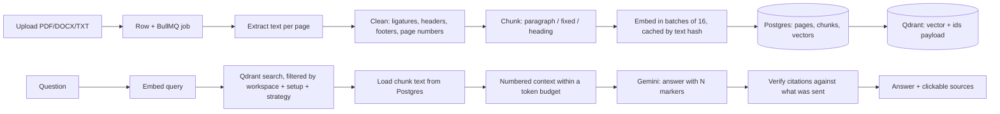
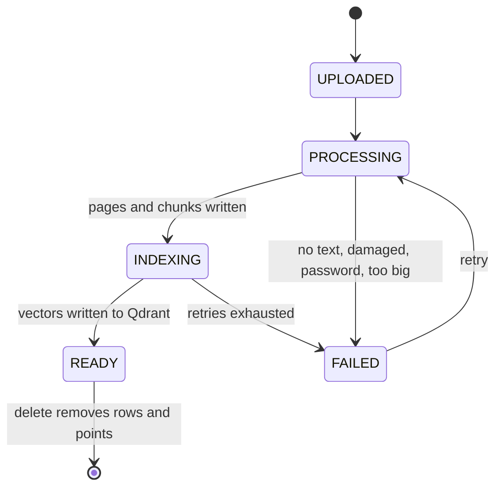
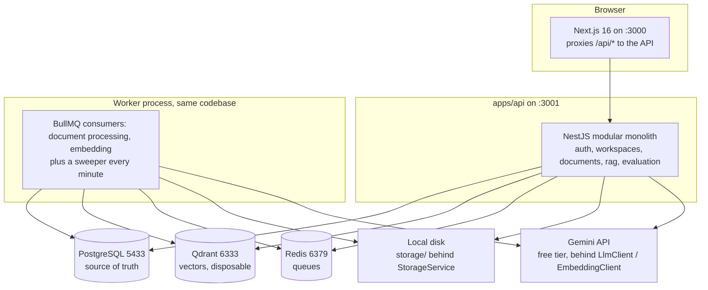

# AI Knowledge Platform

A multi-tenant RAG application: upload company documents (PDF, DOCX, TXT), ask questions, get grounded answers with citations that point at the exact passage used.

Built as Project 1 of a GenAI portfolio program. TypeScript end to end, Gemini free tier, everything running locally in Docker. The parts that make it more than a tutorial chatbot are measured retrieval quality (a real evaluation harness with stored runs), tested tenant isolation, and an ingestion pipeline whose every stage is readable code rather than a framework call.

**Status: 8 of 14 milestones built.** Auth, workspaces, upload, the processing worker, chunking, embeddings, Qdrant retrieval, the evaluation harness, grounded answers and claim-level citations all work and have been checked live. Full evaluation, hybrid search and reranking, prompt-injection defenses, production hardening and deployment are still ahead. Current milestone and checklists: [`docs/PROGRESS.md`](docs/PROGRESS.md). Plan: [`docs/PLAN.md`](docs/PLAN.md).

## What works today

- **Multi-tenant auth.** Email and password (argon2id), session in an httpOnly cookie, workspaces with owner/admin/member roles, workspace switching, member add and remove.
- **Upload with real validation.** PDF, DOCX and TXT, type decided from the file's bytes and cross-checked against the extension, 10 MB cap enforced while streaming, per-workspace duplicate detection by SHA-256.
- **Asynchronous ingestion.** Upload returns immediately, BullMQ queues the job, a separate worker process extracts text page by page, cleans it, chunks it and embeds it. Status flows `Uploaded -> Processing -> Indexing -> Ready`, or `Failed` with a plain reason.
- **Three chunking strategies.** `paragraph` (default, sentences via `Intl.Segmenter`, overlap of whole sentences), `fixed` (naive baseline), `heading` (packs whole sections, cuts only at detected headings). `page.text.slice(startChar, endChar) === chunk.text` is the invariant the rest of the system relies on.
- **Embeddings with a cache.** Content-hash cache per workspace plus an embedding-setup id, batching of 16, token-per-minute limiter for the free tier, vectors stored in Postgres and disposable.
- **Vector search with enforced tenancy.** One Qdrant collection, tenant index on `workspace_id`, and every search filters on workspace, strategy and embedding setup. The workspace comes from the session, never from a request parameter.
- **Grounded answers.** Retrieval through the same code path the evaluation harness uses, numbered context capped by a token budget, a fixed system instruction, refusal by an exact phrase (a similarity threshold cannot separate answerable from unanswerable questions, measured, see results below).
- **Streaming.** SSE from NestJS to Next.js. The browser talks only to the Next.js app, which proxies `/api/*`, and a dedicated Route Handler keeps the SSE connection alive (the generic proxy killed it after about 150 ms).
- **Citations.** An inline `[N]` marker per claim, verified structurally against the passages actually sent to the model. Unverified citations are kept and marked, never silently dropped, so a reader can see when the model cited something it was not given.
- **Evaluation harness.** 22 scored questions, hit rate at 1/3/5 and MRR judged against expected quotes, every run stored in Postgres and as committed JSON under `eval/runs/`.

## RAG pipeline



Document status:



## Architecture



The API and the worker are the same codebase with two entrypoints (`apps/api/src/main.ts` and `apps/api/src/worker.ts`), compiled into separate output folders so two watchers never fight over one `dist`.

### Stack

| Layer | Choice |
|---|---|
| Frontend | Next.js 16, TypeScript, Tailwind 4, shadcn/ui (`radix-nova`, Lucide) |
| Backend | NestJS 12 modular monolith, Zod validation at the edges |
| Database | PostgreSQL 17 with Prisma 7 (`@prisma/adapter-pg`) |
| Vectors | Qdrant v1.19.1, one collection, cosine, 768 dimensions |
| Queue | Redis with BullMQ 6 |
| AI | Google Gemini free tier behind thin `LlmClient` / `EmbeddingClient` interfaces |
| Extraction | `pdfjs-dist` (PDF, page by page) and `mammoth` (DOCX). No Python |
| Runtime | Node 22 for the API and the worker. Bun 1.4 as package manager and script runner |
| Infra | Docker Compose: Postgres on 5433 (5432 is taken on the dev machine), Qdrant, Redis |

Models are pinned in `.env`, not chosen by the code. The stored evaluation runs used `gemini-embedding-2` at 768 dimensions (setup id `gemini-embedding-2|768|d290113f`) and `gemini-3.5-flash-lite` for generation. Changing the embedding model or the dimension invalidates every stored vector, which is why the embedding setup id is part of every search filter and every stored run.

## Where each pipeline stage lives

The pipeline is deliberately plain code. Each stage is a file you can read on its own.

| Stage | File |
|---|---|
| Config, fail-fast env loading | `apps/api/src/config/env.ts` |
| Provider interfaces, retry, rate limiting | `apps/api/src/llm/types.ts`, `resilience.ts`, `gemini/` |
| Upload validation (type from bytes) | `apps/api/src/documents/file-type.ts`, `documents.service.ts` |
| File storage | `apps/api/src/storage/local-disk.storage.ts` |
| Job queue | `apps/api/src/queue/document-queue.service.ts` |
| Worker, consumers, sweeper | `apps/api/src/worker.ts`, `worker/document.worker.ts`, `worker/sweeper.service.ts` |
| Extraction and cleaning | `apps/api/src/processing/extract-document.ts`, `extract-pdf.ts`, `extract-docx.ts`, `clean-text.ts`, `limits.ts` |
| Chunking | `apps/api/src/chunking/paragraph.ts`, `fixed.ts`, `headings.ts`, `save-chunks.ts` |
| Embedding and caching | `apps/api/src/embedding/chunk-embedder.ts`, `document-indexer.service.ts` |
| Vector index and search | `apps/api/src/vector/vector-index.service.ts`, `apps/api/src/search/qdrant-search.ts` |
| RAG, prompt, citations | `apps/api/src/rag/rag.service.ts`, `prompt.ts`, `rag.controller.ts` |
| Evaluation | `apps/api/src/evaluation/runner.ts`, `metrics.ts`, `questions.ts` |
| Tenant scoping | `apps/api/src/prisma/tenant-client.ts`, `apps/api/src/auth/session.guard.ts` |

## Evaluation results

Every number below comes from a stored run in `eval/runs/` and from the eval run row in Postgres. Nothing here is estimated or retyped from memory.

Corpus: 7 GOV.UK employment guides (Open Government Licence v3.0, licences and checksums in `eval/corpus/LICENSES.md`). 22 scored questions (18 answerable, 4 unanswerable), judged by quote, top 5 retrieved per question.

| Strategy | Chunks | Hit rate@1 | Hit rate@3 | Hit rate@5 | MRR@5 | Avg retrieved tokens | Run |
|---|---|---|---|---|---|---|---|
| `paragraph` (default) | 36 | **88.9%** | 100% | 100% | **0.944** | 2,291 | `2026-09-21T11-45-39-paragraph-d3.json` |
| `heading` | 35 | 83.3% | 100% | 100% | 0.907 | 2,184 | `2026-09-21T11-46-02-heading-d3.json` |
| `fixed` | 36 | 66.7% | 100% | 100% | 0.815 | 2,334 | `2026-09-21T11-45-57-fixed-d3.json` |

The `paragraph` baseline run (`2026-09-21T08-58-40-paragraph-baseline.json`) is identical to the `paragraph` row above, question by question, and none of the 18 answerable questions had its quote cut in half by chunking.

Score ranges show why a similarity threshold cannot be used to decide whether to answer: 0.665 to 0.798 when a question is answerable, 0.627 to 0.717 when it is not. The ranges overlap, so the refusal is done with a fixed refusal phrase in the prompt instead.

What these numbers do not show, stated plainly:

- The 22 questions were selected by the assistant, not reworded by a human. The set may flatter search.
- The corpus is small (36 chunks), so hit rate@3 and @5 sit at the ceiling and cannot separate the strategies. Only rank 1 did.
- At this size Qdrant scans everything, so its approximate HNSW index was never actually exercised.
- Chunk sizes (500 target tokens, 60 overlap) are starting guesses and were not measured.
- No cross-encoder reranking yet. That is Milestone 11.

Reproduce:

```
bun run --cwd apps/api eval:check                  # every expected quote is in its document, no API calls
bun run --cwd apps/api eval:run --strategy paragraph --label baseline
bun run --cwd apps/api eval:compare 2026-09-21T11-45-39-paragraph-d3.json 2026-09-21T11-45-57-fixed-d3.json
```

A run refuses to score rather than produce a misleading number: if a quote is not in its document, if Qdrant and Postgres disagree, or if chunks have no vectors under the current embedding setup.

## Tenancy and security

Isolation is enforced on the server and covered by tests, not by convention.

- The session cookie is a JWT holding the user id and the active workspace id. The workspace id is only a claim: a global `SessionGuard` re-reads the membership row on every request, so removing someone ends their access on their next request, and roles live in the database, not in the token.
- Routes are private by default. Opting out takes `@Public()`, narrowing takes `@UserOnly()` and `@Roles(...)`. Tenant data is read from `@CurrentWorkspace()`, never from a URL, body, query or header, so no endpoint accepts a workspace id.
- Tenant tables are reachable only through a workspace-scoped Prisma client (`forWorkspace()`), which injects `workspace_id` into every query and create, drops attempts to set or change it, and refuses operations it does not know. A guard test fails if a model with a `workspaceId` is not registered as tenant or deliberately exempt, and another fails if raw SQL appears in `src/`.
- Vector search filters on `workspace_id` and cannot be called without the filter. The workspace for that filter comes from the scoped client, not from a parameter.
- One cross-tenant query exists on purpose: the worker's sweeper, which must find stuck documents across all workspaces. It lives in `apps/api/src/worker/system-queries.ts`, returns ids only, and is fenced by the same guard test.
- Only public or fictional text may be sent to the provider. The free tier may use submitted data for product improvement, so the demo corpus is fictional, the eval corpus is public government text with licences recorded, and provider-facing scripts filter to those documents.

Not built yet, and deliberately so: login rate limiting and lockout, an Origin check on state-changing requests, prompt-injection defenses and injection demos (Milestone 12), shared rate limiting across processes (Milestone 13).

## Quick start

Requirements: Node 22, Bun 1.4, Docker Desktop, and a free Gemini API key from <https://aistudio.google.com/apikey>.

```bash
# 1. Dependencies and infrastructure
bun install
cp .env.example .env          # then fill in GEMINI_API_KEY, the two model IDs, EMBEDDING_DIMENSIONS and JWT_SECRET
bun run infra:up              # Postgres 5433, Qdrant 6333, Redis 6379
bun run --cwd apps/api db:generate
bun run --cwd apps/api db:migrate

# 2. Run the three programs, one per terminal
bun run api                   # http://localhost:3001
bun run worker                # without it, documents stay Uploaded
bun run web                   # http://localhost:3000

# 3. Load the demo data (safe to repeat)
bun run seed                  # 7 fake users, 9 workspaces, 8 sample documents
bun run --cwd apps/api embed:backfill   # makes the fictional sample documents searchable
```

Open <http://localhost:3000>, sign in as `alice@acme.test` with password `demo-password-123`, upload a file from `demo-files/`, then ask about it. Every check with its expected result is in [`docs/DEMO_GUIDE.md`](docs/DEMO_GUIDE.md).

`bun run samples` writes sample uploads to `demo-files/`. If pages show "Cannot reach the server", the API is not running: start it and press Try again.

Generate the required secret with:

```bash
node -e "console.log(require('crypto').randomBytes(48).toString('base64url'))"
```

### Configuration

`.env` at the project root, loaded by the API, the worker and every script with `node --env-file`. Bad values fail fast at startup.

| Group | Keys |
|---|---|
| Provider | `GEMINI_API_KEY`, `GEMINI_GENERATION_MODEL`, `GEMINI_EMBEDDING_MODEL`, `EMBEDDING_DIMENSIONS` |
| Free-tier throttling | `GEMINI_GENERATION_RPM`, `GEMINI_EMBEDDING_RPM`, `GEMINI_EMBEDDING_TPM`, `GEMINI_MAX_RETRIES` |
| Data stores | `DATABASE_URL`, `REDIS_URL`, `QDRANT_URL`, `QDRANT_COLLECTION` |
| Session | `JWT_SECRET`, `SESSION_DAYS`, `API_PORT` |
| Uploads | `MAX_UPLOAD_MB`, `STORAGE_DIR` (defaults to `storage/`, git-ignored) |
| Worker | `QUEUE_PREFIX`, `WORKER_CONCURRENCY`, `MAX_PDF_PAGES`, `PROCESSING_TIMEOUT_SECONDS` |
| Chunking | `CHUNK_STRATEGY`, `CHUNK_TARGET_TOKENS`, `CHUNK_OVERLAP_TOKENS` |

Chunking settings apply to newly processed documents. To re-cut documents that are already Ready, run `bun run --cwd apps/api chunks:rebuild`.

## API

All routes are workspace-scoped and require a session unless marked public. The browser reaches them through the Next.js proxy at `/api/*`.

| Method | Path | Purpose |
|---|---|---|
| GET | `/health` | Liveness. Public |
| POST | `/auth/register` | Create a user plus a personal workspace. Public |
| POST | `/auth/login` | Start a session cookie. Public |
| POST | `/auth/logout` | Clear the cookie. Public |
| GET | `/auth/me` | Current user and their workspaces |
| POST | `/auth/switch-workspace` | Change the active workspace after a membership check |
| POST | `/workspaces` | Create a workspace |
| GET | `/workspaces/current/members` | List members of the active workspace |
| POST | `/workspaces/current/members` | Add a member by email (owner or admin) |
| DELETE | `/workspaces/current/members/:userId` | Remove a member (owner or admin, owner cannot be removed) |
| GET | `/documents` | List documents with status, counts and failure reason |
| POST | `/documents` | Upload a file, returns immediately with a queued job |
| GET | `/documents/:id/pages` | Extracted text page by page |
| GET | `/documents/:id/chunks` | Chunks with positions, overlap and vector status |
| POST | `/documents/:id/retry` | Re-queue a failed document |
| DELETE | `/documents/:id` | Delete a document, its rows, its file and its vectors |
| POST | `/ask` | Answer a question, with citations, in one JSON reply |
| GET | `/ask/stream` | The same answer as an SSE stream (GET because `EventSource` cannot send a body) |

## Repository layout

```
ai-knowledge-platform/
  apps/
    api/          NestJS API and the worker, plus Prisma schema, migrations and every script
    web/          Next.js app: documents, members, ask, auth pages
  eval/
    corpus/       GOV.UK guides as plain text, with licences, manifest and checksums
    questions/    Question set with expected answers and quotes
    runs/         Every stored evaluation run as JSON
  docs/           PLAN, PROGRESS, DEMO_GUIDE, frontend rules, learning notes and milestone folders
  demo-files/     Sample files for manual uploads
  storage/        Uploaded files, git-ignored
  docker-compose.yml
```

## Commands

| Command | What it does |
|---|---|
| `bun run infra:up` / `infra:down` / `infra:logs` | Docker Compose: Postgres, Qdrant, Redis |
| `bun run api` / `bun run web` / `bun run worker` | The three programs |
| `bun run seed` | Demo users, workspaces and sample documents |
| `bun run samples` | Write sample uploads into `demo-files/` |
| `bun run test` | API test suite against the `akp_test` database |
| `bun run smoke:gemini` | Real provider calls to check the key, the models and the embedding dimension |
| `bun run --cwd apps/api list:models` | Ask the API which models this key can call |
| `bun run --cwd apps/api search` | Interactive retrieval against a workspace, `--exact` and `--compare` modes |
| `bun run --cwd apps/api eval:run` | Score a stored evaluation run; `--strategy`, `--label`, `--exact`, `--no-store` |
| `bun run --cwd apps/api eval:check` | Verify every expected quote is in its document and in one chunk |
| `bun run --cwd apps/api eval:prepare --strategy <name>` | Cut, embed and index one strategy for the eval workspace |
| `bun run --cwd apps/api eval:compare <run> <run>` | Compare stored runs side by side (file names from `eval/runs/`; it refuses runs from different question files or embedding setups) |
| `bun run --cwd apps/api chunks:rebuild [--strategy fixed]` | Re-cut chunks for Ready documents from stored pages |
| `bun run --cwd apps/api chunks:lab <file>` | Offline look at heading detection and how each strategy cuts a file. The path is read from `apps/api`, so pass `../../eval/corpus/govuk/govuk-flexible-working.txt`. Add `--show heading` to list the chunks |
| `bun run --cwd apps/api embed:backfill` | Embed Ready documents that have no vectors (sample documents only by default) |
| `bun run --cwd apps/api qdrant:sync [--check]` | Compare Qdrant with Postgres and repair the difference |
| `bun run --cwd apps/web check:contrast` | Contrast check on every text pair in light and dark |

## Design decisions worth knowing

| Decision | Why |
|---|---|
| Postgres is the source of truth, Qdrant holds only vectors and ids | Vectors are disposable and rebuildable. Chunk text, needed for citations, lives in one place, and `qdrant:sync` can always reconcile the two stores |
| One Qdrant collection with a tenant-indexed `workspace_id` payload | The standard multi-tenancy pattern for Qdrant. A filter applied during search, enforced server-side, covered by tests |
| Chunk invariant `page.text.slice(start, end) === chunk.text` | Page coordinates are stored with every chunk, so a cited passage can be located in the original text and a wrong offset is detectable |
| Refusal by exact phrase, not by score threshold | Measured: answerable and unanswerable questions produce overlapping similarity ranges |
| Provider behind `LlmClient` / `EmbeddingClient` only | The one early abstraction. Everything else in the pipeline stays visible, and the fake clients used by tests never send text out |
| Embedding cache keyed by workspace, text hash and setup id | Free-tier embedding quota is the binding constraint, and re-running chunking experiments must not re-embed unchanged text |
| SSE instead of WebSockets | One-way token streaming. `EventSource` cannot send a body, so the question travels in the query string |
| API and worker as one codebase, two entrypoints | No microservices. The worker gets its own output folder and its own process, and shares every module with the API |

## Limitations

- Scans and images are not read (no OCR), and tables and multi-column PDFs extract poorly. Those fail with a clear reason, or extract with interleaved order. OCR belongs to a later project.
- The provider rate limiter is per process and in memory. With the worker as a separate process, a shared Redis-backed limiter is needed (Milestone 13).
- Login has no rate limiting or lockout yet, and no Origin check on state-changing requests beyond `SameSite=Lax`. Milestone 13.
- A single file's size cap is enforced while streaming, but the web proxy answers 500 rather than 413 for a body above its 20 MB buffer. The browser UI checks size before sending, and direct API callers get the correct 413.
- Two stores cannot share a transaction. Qdrant is written last, so a crash after the Postgres commit leaves a document Ready without points until the queue retries or `qdrant:sync` runs.
- Sentence-level citation highlighting is deferred. Citation chips open the cited chunk with the whole passage highlighted.
- The worker is started by hand and nothing restarts it. Deployment work is Milestone 14, along with object storage behind the existing `StorageService` interface.
- No screenshots are committed yet. They arrive with the deployment and documentation milestone.

## Roadmap

| # | Milestone | State |
|---|---|---|
| 1 to 8 | Setup, auth and workspaces, upload and storage, processing worker, chunking and embeddings, Qdrant retrieval with the mini evaluation, basic RAG, citations | Done and checked live |
| 9 | Conversational RAG: conversation state, query rewriting, history compaction, tool calling basics | Next |
| 10 | Full evaluation: 50-question dataset with human curation, faithfulness, answer relevance, citation correctness | Planned |
| 11 | Hybrid search (Postgres full-text plus vectors, merged with RRF) and reranking, measured against the Milestone 10 baseline | Planned |
| 12 | Security: prompt-injection demos against RAG, malicious documents, defenses, tenant-leakage tests | Planned |
| 13 | Production hardening: shared rate limiting, usage and cost tracking, logging, error handling, API docs | Planned |
| 14 | Deployment and documentation: object storage, screenshots, case study | Planned |

Out of scope for this project: microservices, Kubernetes, fine-tuning, self-hosted models, agents, OCR, business billing, SSO, connectors, document versioning.

## Documentation map

| File | Contents |
|---|---|
| [`docs/PLAN.md`](docs/PLAN.md) | Architecture, data model, milestones, verified provider facts and quotas |
| [`docs/PROGRESS.md`](docs/PROGRESS.md) | Every milestone checklist, known gaps, decisions and lessons |
| [`docs/DEMO_GUIDE.md`](docs/DEMO_GUIDE.md) | Demo accounts and step-by-step checks with expected results |
| [`docs/learning/`](docs/learning/README.md) | Topic notes: tokens, embeddings, chunking, RAG, retrieval, evaluation, tenant isolation, background jobs |
| [`docs/learning/milestones/`](docs/learning/milestones/README.md) | Per-milestone goals, plan checklists and checkpoint results |
| [`docs/FRONTEND_RULES.md`](docs/FRONTEND_RULES.md) | Binding rules for the UI: tokens, fonts, states |

## Third-party content

The evaluation corpus is GOV.UK employment guidance, used under the Open Government Licence v3.0. Contains public sector information licensed under the Open Government Licence v3.0. Source addresses, checksums, the rebuild script and the licence check for every candidate document are in [`eval/corpus/LICENSES.md`](eval/corpus/LICENSES.md) and [`eval/corpus/manifest.json`](eval/corpus/manifest.json).

All other demo data is fictional: the seed creates users on reserved `.test` addresses, invented company workspaces, and sample documents written for this project.
